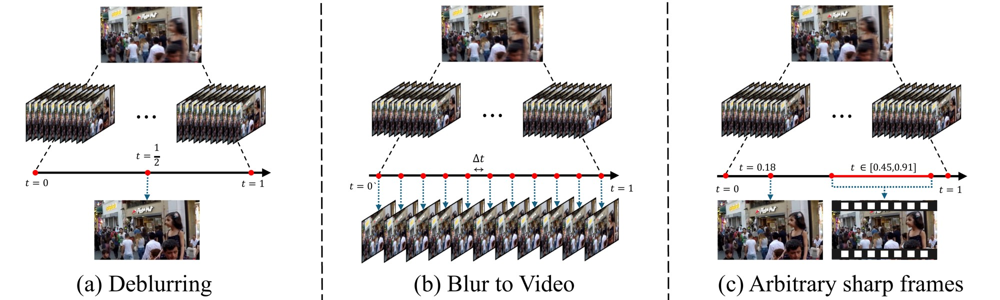
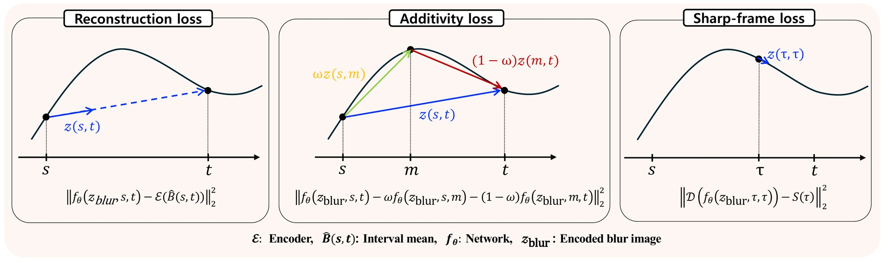
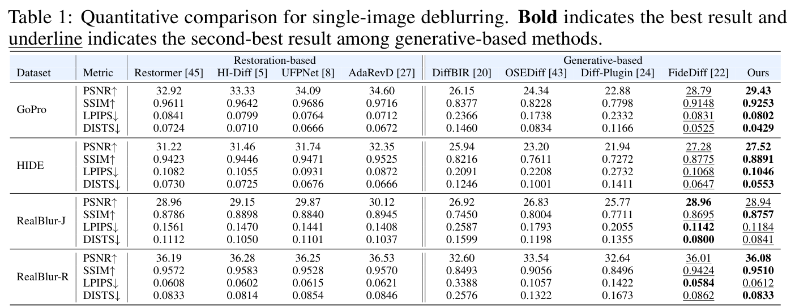
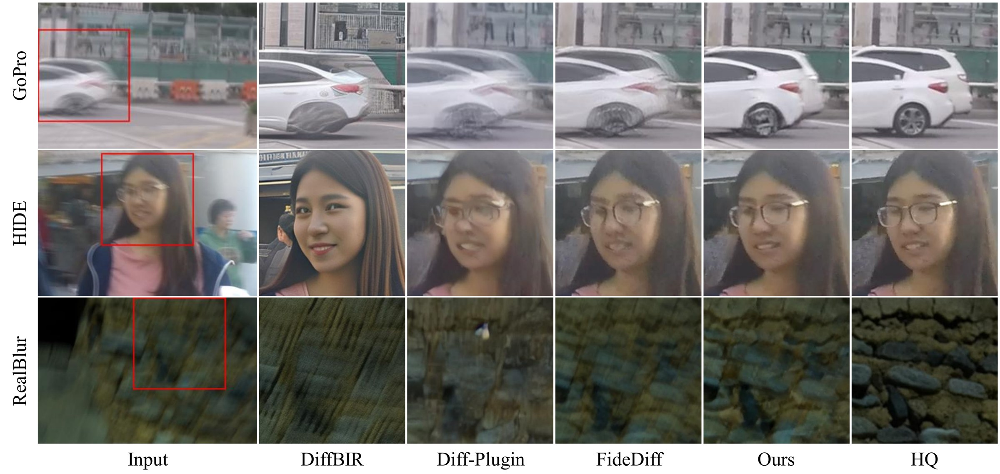
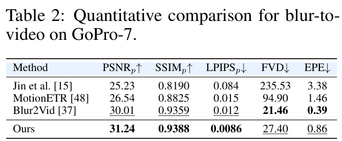
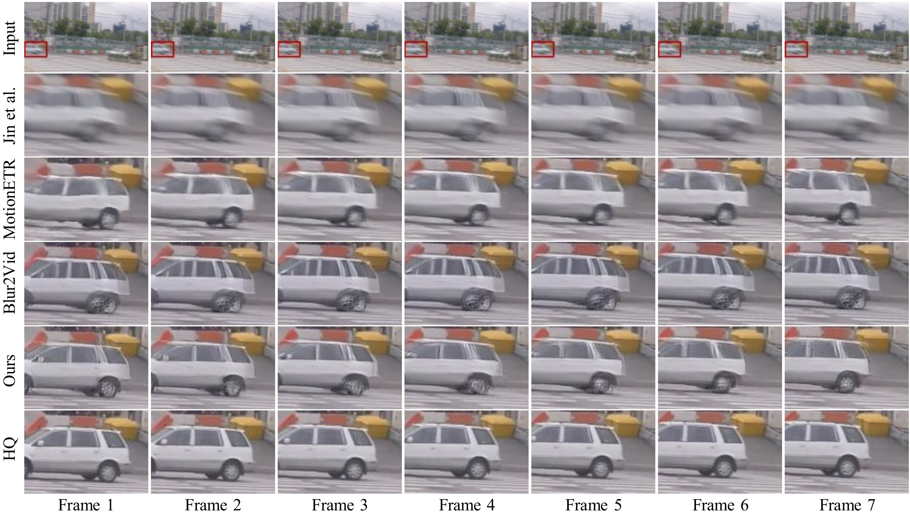

<div align="center">

# PickMoment: Single-Image-to-Video via Learning Continuous-Time Reblurring

[Junseong Shin](https://junsung6140.github.io/)<sup>1</sup> · Hyeonsu Jo<sup>2</sup> · [Daehyun Kim](https://kdhrick2222.github.io/)<sup>3</sup> · [Tae Hyun Kim](https://sites.google.com/view/lliger9/)<sup>1,3†</sup>

<sup>1</sup>Department of Artificial Intelligence, Hanyang University · <sup>2</sup>Department of Intelligence Convergence, Hanyang University · <sup>3</sup>Department of Computer Science, Hanyang University

**NeurIPS 2026**

[](https://junsung6140.github.io/pickmoment_project_page/)
[](https://arxiv.org/abs/2610.01279)
[](LICENSE)

</div>



From a single motion-blurred image, one PickMoment model does three things: **(a)** single-image deblurring (the center sharp frame), **(b)** blur-to-video (N sharp frames over the exposure), and **(c)** pick-a-moment recovery (a sharp frame at any time inside the exposure). Each output is one forward pass, with no iterative sampling.

## News

- **2026-10**: Code, pretrained weights, and our result images are released.
- **2026-09**: PickMoment is accepted to NeurIPS 2026.

## Abstract

Motion blur arises from the temporal integration of a continuous sharp signal over a finite exposure window, yet existing learning-based methods sidestep this physical model and predict only the sharp signal itself: most single-image deblurring methods recover a single frame at the exposure center, while blur-to-video methods predict a fixed set of frames. We introduce PickMoment, a continuous-time reformulation that directly learns the interval-mean blur over arbitrary sub-intervals of the exposure with a single deterministic model. Drawing an analogy to MeanFlow's average-velocity formulation, we train the model with three supervisions derived from the blur integral: an empirical reconstruction loss from available subframes, an additivity loss that enforces self-consistency across overlapping sub-intervals, and a sharp-frame loss anchored at the zero-interval limit. A single trained model unifies single-image deblurring, blur-to-video generation, and continuous-time pick-a-moment recovery as different queries to the same network, with no separate training for each task. Our PickMoment achieves state-of-the-art performance among generative-based deblurring methods on GoPro and HIDE while competitive against restoration-based methods on RealBlur, and the highest per-frame fidelity on GoPro-7 blur-to-video, all in a single forward pass without iterative sampling.

## Method



The model takes a blurry image and a time interval (s, t) inside the exposure, and predicts the mean of the sharp frames over that interval. It is trained with three losses: reconstruction against the mean of the ground-truth sub-frames, additivity across split intervals, and a sharp-frame loss at the zero-length interval s = t. At test time, a sharp frame at time τ is the prediction for the tiny interval (τ - ε, τ + ε).

## Results

### Single-image deblurring

<p align="center"></p>



### Blur-to-video

<p align="center"></p>



Our result images for all test sets above (GoPro, HIDE, RealBlur-J, RealBlur-R, and GoPro-7 blur-to-video) can be downloaded [here](TODO_GOOGLE_DRIVE_RESULTS_LINK).

## Getting started

### Installation

```bash
git clone https://github.com/junsung6140/PickMoment.git
cd PickMoment
conda create -n pickmoment python=3.10 -y
conda activate pickmoment
pip install -r requirements.txt
```

The backbone is [FLUX.2-klein-4B](https://huggingface.co/black-forest-labs/FLUX.2-klein-4B). By default it is loaded from the Hugging Face Hub by its id. To use a local copy, set `model.backbone` in the configs (or `--backbone` in `inference.py`) to the folder, for example `checkpoints/FLUX.2-klein-4B`.

### Pretrained model

| Model | Backbone | Size | Download |
|---|---|---|---|
| PickMoment | FLUX.2-klein-4B (full transformer fine-tune) | 7.8 GB | [Google Drive](TODO_GOOGLE_DRIVE_CKPT_LINK) |

Unzip it so that the file is at `checkpoints/best_model.pt`. This is the default path in all scripts. To use another path, pass `--checkpoint path/to/best_model.pt`.

### Inference

Time inside the exposure is normalized to [-1, 1]: -1 is the start, 0 is the center, and 1 is the end. Inputs of any size are padded to a multiple of 32.

```bash
# Deblurring: the center sharp frame (tau = 0)
python inference.py --input path/to/blurry.png --output_dir outputs

# Pick-a-moment: sharp frames at any moments in [-1, 1]
python inference.py --input path/to/blurry.png --output_dir outputs --tau -1 -0.5 0 0.37 1

# Blur-to-video: N frames at uniform moments from -1 to 1 (also saved as mp4)
python inference.py --input path/to/blurry.png --output_dir outputs --n_frames 11 --save_mp4
```

`--input` can also be a folder. Use `--max_batch` to lower memory use with `--n_frames`.

### Data preparation

Put all datasets under `data/` (or edit the paths in `configs/`):

```
data/
├── GOPRO_Large/                  # GoPro (only "frames N offset M.txt" per scene is read)
│   ├── train/GOPR0372_07_00/ ...
│   └── test/GOPR0384_11_00/ ...
├── GOPRO_Large_subframes/        # all 240 fps frames of GoPro (GOPRO_Large_all)
│   ├── train/GOPR0372_07_00/*.png
│   └── test/GOPR0384_11_00/*.png
├── HIDE_test/
│   ├── input/*.png
│   └── target/*.png
├── RealBlur_test/
│   ├── RealBlur-J/{input,target}/*.png
│   └── RealBlur-R/{input,target}/*.png
├── GOPRO_7_linear/               # made by scripts/prepare_gopro7_linear.py
│   └── test/blur/{scene}/{center_idx}.png
└── GOPROResultsImages/
    └── GT/{scene}/{center_idx}/frame_00000.png ... frame_00006.png   # GoPro-7 GT, 640x360
```

- **GoPro**: download `GOPRO_Large` and `GOPRO_Large_all` from the [GoPro dataset page](https://seungjunnah.github.io/Datasets/gopro), and rename (or symlink) `GOPRO_Large_all` to `GOPRO_Large_subframes`. Training and testing read the raw sub-frames: each blurry input is the pixel average of the N sub-frames of one GoPro blur, and the GT sharp frame is the center sub-frame. The `blur/` and `sharp/` folders of `GOPRO_Large` are not used.
- **HIDE and RealBlur**: use the test sets in the `input/` and `target/` layout above (the same layout used by MPRNet and Restormer).
- **GoPro-7 (blur-to-video)**: build the 7-frame blur inputs from the GoPro test sub-frames with the command below. For the GT clips, use the 640x360 GoPro-7 ground truth from the [Blur2Vid](https://github.com/tedlasai/blur2vid) evaluation release and place it under `data/GOPROResultsImages/GT`.

```bash
python scripts/prepare_gopro7_linear.py \
    --src_root data/GOPRO_Large_subframes \
    --save_root data/GOPRO_7_linear \
    --splits test --window_size 7
```

### Evaluation

Run everything in Table 1 and Table 2:

```bash
bash scripts/test_all.sh
# or with another checkpoint / output folder
CHECKPOINT=path/to/best_model.pt OUT_DIR=results bash scripts/test_all.sh
```

Single-image deblurring (Table 1). PSNR and SSIM on GoPro and HIDE are computed on RGB uint8 images (SSIM with the 3D Gaussian kernel of AdaRevD). RealBlur uses the official ECC alignment. LPIPS uses AlexNet.

```bash
python test.py --config configs/test.yaml --mode gopro_deblur      --output_dir results/gopro
python test.py --config configs/test.yaml --mode hide_deblur       --output_dir results/hide
python test.py --config configs/test.yaml --mode realblur_j_deblur --output_dir results/realblur_j
python test.py --config configs/test.yaml --mode realblur_r_deblur --output_dir results/realblur_r
```

Blur-to-video on GoPro-7 (Table 2). Frames are predicted at full resolution, downsampled 2x to 640x360, and scored with the Blur2Vid protocol (best of forward and reversed order, patch SSIM and LPIPS on 40x40 patches, FVD, RAFT EPE).

```bash
python test_blur2vid.py --config configs/test.yaml \
    --blur_dir data/GOPRO_7_linear/test/blur \
    --gt_dir data/GOPROResultsImages/GT \
    --output_dir results/blur2vid \
    --n_frames 7 --with_epe --with_fvd
```

Per-frame video quality on GoPro-11 at full resolution:

```bash
python test.py --config configs/test.yaml --mode gopro_perframe --n_frames 11 --output_dir results/gopro11_perframe
```

### Training

```bash
accelerate config          # once, to set the number of GPUs
bash scripts/train.sh      # add --wandb to log to Weights & Biases
```

`configs/train.yaml` holds the settings of the released model:

- Full fine-tuning of the FLUX.2-klein-4B transformer. The VAE is frozen.
- One NVIDIA RTX A6000 (48 GB), about 4 days.
- 100K steps, bf16 mixed precision, gradient checkpointing, AdamW with learning rate 1e-4, 2K warmup steps, then cosine decay to 1e-5.
- Progressive patch size 256, 384, 512 with batch size 8, 4, 2 (switching at 30K and 60K steps), and gradient accumulation 2.
- Losses: interval-mean reconstruction (latent L2), sharp-frame loss at the zero-interval limit (pixel L1 + 2 x edge-aware LPIPS with VGG), and additivity loss (latent L2, weight 0.1, enabled after 2K steps).

The best checkpoint on the GoPro validation subset (9 blurs per test scene) is saved as `outputs/pickmoment/best_model.pt`.

## Citation

```bibtex
@inproceedings{shin2026pickmoment,
  title     = {PickMoment: Single-Image-to-Video via Learning Continuous-Time Reblurring},
  author    = {Shin, Junseong and Jo, Hyeonsu and Kim, Daehyun and Kim, Tae Hyun},
  booktitle = {Advances in Neural Information Processing Systems (NeurIPS)},
  year      = {2026}
}
```

## License

The code and the PickMoment weights are released under the [CC BY-NC 4.0](https://creativecommons.org/licenses/by-nc/4.0/) license (see [LICENSE](LICENSE)). The model is fine-tuned from FLUX.2-klein-4B, which has its own license from Black Forest Labs. Please also follow its terms when you use the weights.

## Acknowledgements

This code is built on [FLUX.2](https://github.com/black-forest-labs/flux2) and [diffusers](https://github.com/huggingface/diffusers). The blur-to-video evaluation follows the protocol of [Blur2Vid](https://github.com/tedlasai/blur2vid). The RealBlur evaluation follows the official [RealBlur](https://github.com/rimchang/RealBlur) ECC alignment code.
